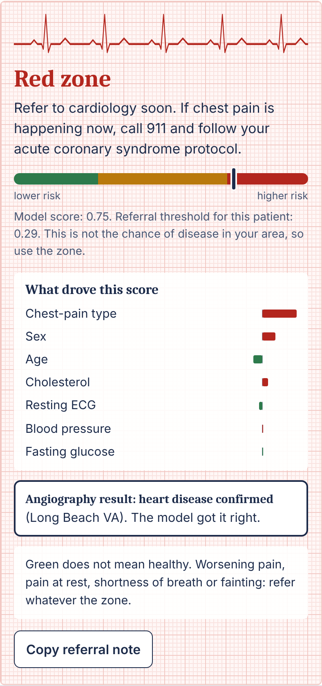
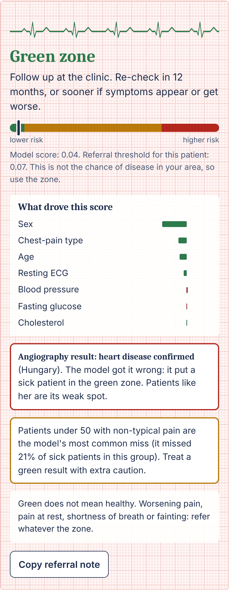
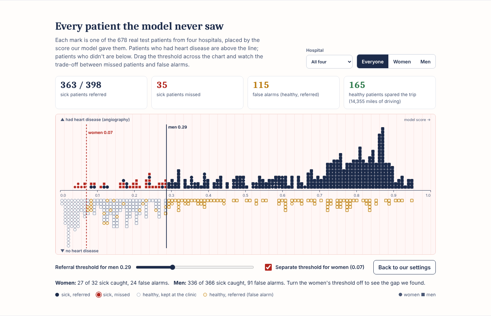
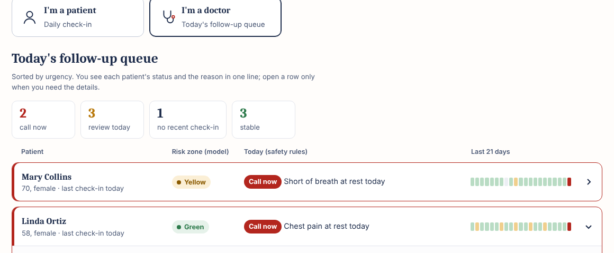
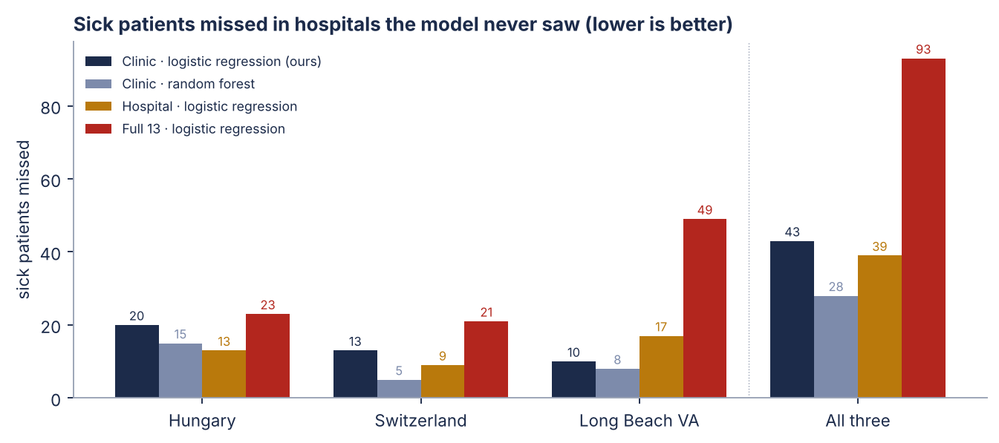
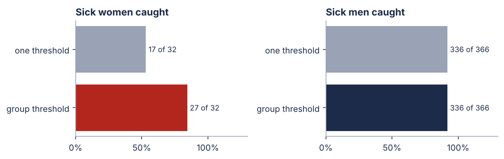
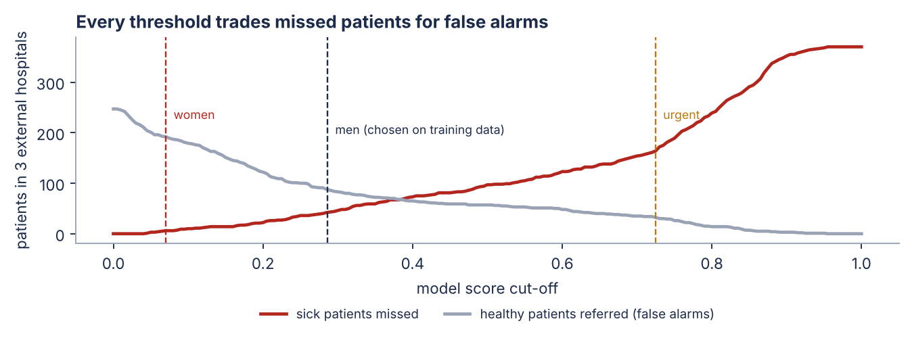

# HeartPost: heart-disease triage for rural clinics without a cardiologist

**Track:** Health
**Team:** Yeva (captain), Ipatiy, Ariana

> **This project is a prototype and is not medical advice.**

**Live tool:** https://avenyx-alt.github.io/HeartPost/ ([`app/index.html`](app/index.html), works offline, English / Spanish / Russian) · **Code and all results:** [`HeartPost.ipynb`](HeartPost.ipynb) · [Open in Colab](https://colab.research.google.com/github/Avenyx-alt/HeartPost/blob/main/HeartPost.ipynb) · **Demo video (2 min):** https://youtu.be/onxwtUJJg8Q

> **In two minutes:** we built a heart-disease triage tool that uses only the 7 measurements a small rural clinic has. Trained on one US hospital, it was tested in three hospitals it never saw. There it missed **43** sick patients, while the textbook 13-measurement model missed **93**. We also found it missed half of sick women and fixed most of that: **27 of 32** caught, up from 17.

<table><tr>
<td width="50%"></td>
<td width="50%"></td>
</tr><tr>
<td>A real unseen patient from Long Beach VA, correctly sent to the red zone.</td>
<td>A real patient from Hungary the tool gets wrong. The app shows its own mistakes.</td>
</tr></table>

## The problem
Heart disease is the leading cause of death in the US, and in 2019 the heart-disease death rate in rural areas was 21% higher than in cities. **46% of US counties have no practicing cardiologist, including 86% of rural counties.** Patients there drive about 87 miles round trip to see one. So the first person to see a rural patient with chest pain is often a nurse practitioner or physician assistant at a small clinic, with no stress-test lab. They must decide quickly whom to send on that long trip. Send too few, and heart disease is missed. Send everyone, and patients lose a day of work for nothing while the cardiology waitlist grows.

## What we built
A browser tool for the rural clinician. **In:** the 7 things a small clinic can measure: age, sex, chest-pain type, resting blood pressure, cholesterol (point-of-care test), fasting glucose (glucometer) and resting ECG. Cholesterol, sugar and ECG can be left blank. **Out:** a 🟢 green, 🟡 yellow or 🔴 red zone with a concrete action (follow up at the clinic / routine cardiology referral / refer soon or call 911), a bar chart of what drove the score, and warnings where we know the model is weak. The tool runs fully in the browser in English, Spanish or Russian, and it works offline, which matters where rural internet is unreliable. No patient data leaves the device. Two more features: **"Try a real patient"** buttons load unseen test patients and reveal their true angiography result (including one the model gets wrong), and **"Copy referral note"** turns the result into text for the paper referral form.

**Every patient the model never saw.** The app also plots all 678 unseen test patients at once, placed by their score, with sick patients above the line and healthy ones below. Judges can drag the referral threshold and watch missed cases, false alarms and "87-mile trips avoided" update live. They can filter by hospital or sex, switch the women's threshold off to see the gap we found, and hover any mark to see that real patient. The counters at our settings match the notebook exactly (35 missed, 115 false alarms).

**Every result explains itself.** Each input has a "Why we ask" note. Under every result, "How this score was calculated" shows the exact arithmetic: the starting value plus or minus points for each measurement, then the logistic formula, then the comparison with the thresholds. A judge can check any score by hand.

**Remote follow-up (demo, synthetic patients).** On a second page ([`app/followup.html`](app/followup.html)), with separate **patient app** and **clinician dashboard** views, a patient checks in from home once a day: symptoms, home blood pressure, and resting pulse typed in or imported from a fitness-band CSV. A city cardiologist doesn't read everyone's numbers. They see a queue sorted by who needs a call today. The **risk zone** comes from the same model, using the clinic-visit measurements with blood pressure updated to the week's home average. The daily **status** (call now / review / stable / no check-in) comes from simple safety rules, *not* the model. We kept daily symptoms out of the model on purpose: in the 1980s data "no chest pain" meant *higher* risk, so a patient who felt better would turn red. Resting pulse is shown but not scored, because our training data has none. To follow the hackathon rules on personal data, there are no accounts and no real people: 9 invented patients, with check-ins stored only in the browser. A real version would need secure accounts, push reminders and clinical review of the rules.

## What we added
We started from the suggested project *4.1.2 Heart disease risk from checkup data* and added:
1. **Our own user and setting:** a rural clinic with no cardiologist. We limit the model to inputs such a clinic actually has. Stress tests, fluoroscopy and thallium scans are only available at the cardiology centre the patient hasn't reached yet.
2. **Our own question: does it work in hospitals it has never seen?** We train **only on Cleveland** and test on Hungary, Switzerland and Long Beach VA (617 patients).
3. **A fairness check and a fix:** results by sex and age, four ways to fix the gap we found, and a measured trade-off.
4. **Triage zones** instead of a bare percentage, plus a working offline app that matches the model's numbers exactly.

## How it works
**Data:** UCI Heart Disease, 920 patients from 4 hospitals. Missing values marked `?`, and impossible zeros (cholesterol = 0 for *every* Swiss patient), are treated as missing and filled with the training median. Without this step, a model learns "cholesterol 0 ⇒ sick". The target is `num > 0`: more than 50% narrowing of a coronary artery on angiography. Cleveland is split 80/20 (stratified): 242 patients for training and 61 for the internal test.
**Model:** logistic regression on the 7 clinic inputs (scaled, chest pain and ECG one-hot encoded). We chose it because it can be explained per patient and runs offline in a few lines of JavaScript. **The referral threshold is chosen on training data only**: the highest cut-off that still catches ≥90% of sick patients in 5-fold cross-validation (0.29). The "urgent" cut-off is set so that ≥85% of training patients above it were sick (0.72).

## Results
All numbers are on patients the model never saw. FN = sick patients missed, FP = false alarms.

| Method | Cleveland test (28 sick / 33 healthy) | 3 new hospitals (370 sick / 247 healthy) |
|---|---|---|
| Baseline: most common class ("nobody is sick") | 28 FN · 0 FP · recall 0.00 · accuracy 0.54 | 370 FN · 0 FP · recall 0.00 · accuracy 0.40 |
| Baseline: refer everyone | 0 FN · 33 FP · recall 1.00 · accuracy 0.46 | 0 FN · 247 FP · recall 1.00 · accuracy 0.60 |
| Baseline: one rule ("refer if no chest pain"†) | 6 FN · 5 FP · recall 0.79 · accuracy 0.82 | 83 FN · 65 FP · recall 0.78 · accuracy 0.76 |
| **Ours: clinic model** | **2 FN · 9 FP · recall 0.93 · accuracy 0.82** | **43 FN · 87 FP · recall 0.88 · accuracy 0.79** |
| Textbook 13-input model | 0 FN · 11 FP · recall 1.00 · accuracy 0.82 | **93 FN** · 58 FP · recall 0.75 · accuracy 0.76 |

† "Asymptomatic" chest pain was the strongest single rule learned from the training data.

Accuracy alone hides what matters here. On the Cleveland test, our model, the one-rule baseline and the 13-input model all score 0.82, but they miss 2, 6 and 0 sick patients. For a screening tool, missed cases are the number to watch, so we chose thresholds for recall (≥90% in training cross-validation, 0.29) rather than for accuracy.

**Most important measurements** (logistic-regression coefficients on standardised inputs): having **no chest pain** at all ("asymptomatic", +1.63) pushes risk up most, then **male sex** (+0.92) and **age** (+0.45). Atypical (−0.67), typical (−0.50) and non-anginal (−0.45) chest pain push it down. Blood pressure (+0.26), cholesterol (+0.23) and an LVH pattern on the ECG (+0.30) matter much less, and fasting glucose barely matters (+0.01). See `figures/what_drives_score.png`.

**Main takeaway:** the 13-input model looks perfect at home and then **misses more than twice as many sick patients in new hospitals** (93 vs 43). It needs test results that are missing in those hospitals. Filling them with Cleveland's typical values ("0 blocked vessels", "normal thallium scan") makes every patient look healthy. This was true in **all 100** random re-splits we tried (median 33 vs 83 missed). AUC of our model: 0.87 Cleveland, 0.84 Hungary, 0.75 Switzerland, 0.71 VA.

**Fairness.** With one threshold the model caught **92% of sick men but only 53% of sick women** (Hungary: 3 of 12). We compared four fixes (removing `sex`, reweighting, group thresholds). The deployed tool uses a rule fixed on training data: *every group must reach ≥90% recall in training cross-validation*. This lowers the women's threshold to 0.07. Missed women fell from **15 to 5** at a cost of 19 extra false alarms among women, and men were unchanged. Caveats: only 32 sick women are in the test, and we picked this option after seeing all four results. Patients under 50 are still missed most (recall 0.79 vs 1.00 for 60+).

**Where it fails.** In the final tool, 35 of 398 sick patients landed in the green zone. 86% of them had atypical or non-anginal chest pain and none had "asymptomatic" pain. 22 of the 35 were women or men under 50, and 71% had a normal ECG. One example is a 47-year-old Hungarian woman with non-anginal pain (score 0.04). Without a stress test, these patients look like the healthy majority. The model also copied a **data artefact**: in Cleveland only 32% of patients with *typical* angina were sick (vs 71% of those with no pain), probably because of who got sent for angiography. So it under-rates typical angina, which is medically backwards. The app shows a warning in that case. The model also under-predicts risk where disease is common (Switzerland: average score 0.64 vs 93% actually sick). That is why we show zones rather than "% chance".

## What we'd do next
1. Validate on present-day US data. The UCI patients are from the 1980s and mostly men. Possible sources are a public dataset such as MIMIC, or an IRB-approved partnership with a rural health system, aiming for many more women and a racially diverse population.
2. Run a usability test with practising rural clinicians (we have not done this yet), have a medical interpreter check the Spanish interface, and try a random-forest model. It missed fewer patients (28 vs 43) but raised more false alarms.

## Sources
* Data: Janosi, Steinbrunn, Pfisterer & Detrano (1988), *Heart Disease*, UCI Machine Learning Repository, https://doi.org/10.24432/C52P4X (CC BY 4.0). Files mirrored from https://github.com/nyuvis/datasets.
* Libraries: [scikit-learn](https://scikit-learn.org), [pandas](https://pandas.pydata.org), [NumPy](https://numpy.org), [Matplotlib](https://matplotlib.org). The app is plain HTML/JavaScript with no external libraries. Hosted on [GitHub Pages](https://pages.github.com).
* Context: CDC NCHS Data Brief No. 417 (2021), *Trends in Death Rates in Urban and Rural Areas: United States, 1999–2019*, https://www.cdc.gov/nchs/products/databriefs/db417.htm. Kim, Warraich et al. (2024), research letter in *JACC* on counties without a cardiologist, summarised by the American College of Cardiology: https://www.acc.org/Latest-in-Cardiology/Articles/2024/07/08/11/54/No-Practicing-Cardiologist-in-Nearly-Half-of-US-Counties
* AI tools: [Claude](https://claude.ai) (Anthropic) helped write code, text and the Spanish and Russian translations. Every part was reviewed by the team, who can explain it.
* Starting point: suggested project 4.1.2 "Heart disease risk from checkup data" from the Veritas AI Project Briefs. No pretrained models or other tutorials were used.

---
### Repository
| File | What it is |
|---|---|
| `HeartPost.ipynb` | Full analysis with all outputs (open in Colab: *File → Upload notebook*, or from GitHub) |
| `notebook_src.py` | The same notebook as a plain Python script |
| `app/index.html` | The offline triage tool (model built in) |
| `app/followup.html` | Remote follow-up demo: patient check-in and doctor queue (synthetic patients) |
| `app/*.json` | Exported model, test results, real example patients and story numbers (all written by the notebook) |
| `data/` | The four UCI hospital files |
| `figures/` | All charts (made by the notebook) and app screenshots |
| `docs/` | One-page write-up (`WRITEUP.md`, `HeartPost_writeup.pdf`), demo-video script and voice-over subtitles |
| `tools/` | Rebuild everything: `python3 tools/build_notebook.py notebook_src.py HeartPost.ipynb`, then `python3 tools/build_app.py .` |
